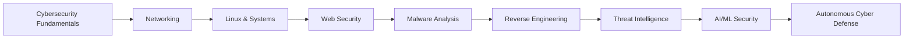

<!-- ============================================================ -->
<!--                     PROFILE HEADER                           -->
<!-- ============================================================ -->

<p align="center">
  
</p>

<p align="center">
  
</p>

---

# 🛡️ `B SWATHI PRASAD`

### Cybersecurity Researcher × AI/ML Engineer × Systems Developer

> Building intelligent systems for malware analysis, threat intelligence, reverse engineering, and autonomous cyber defense.

<p align="center">

[](https://github.com/SwathiPrasad-18)

[](https://github.com/SwathiPrasad-18)

</p>

---

## ⚡ SYSTEM.STATUS

```yaml
Name: B Swathi Prasad
Role: Cybersecurity Researcher × AI/ML Engineer
Focus:
  - Malware Analysis
  - Reverse Engineering
  - Threat Intelligence
  - AI/ML for Cybersecurity
  - Digital Forensics
  - Systems Programming

Currently Building:
  - REM
  - OBSIDIAN
  - SysAnalyzer

Status: BUILDING • RESEARCHING • CONTRIBUTING
```

---

# 🧠 ABOUT_ME

```python
class CybersecurityResearcher:

    def __init__(self):
        self.name = "B Swathi Prasad"
        self.role = "Cybersecurity Researcher × AI/ML Engineer"

        self.interests = [
            "Malware Analysis",
            "Reverse Engineering",
            "Threat Intelligence",
            "AI Security",
            "Digital Forensics",
            "Network Security",
            "Systems Programming"
        ]

        self.languages = [
            "Python",
            "C++",
            "Rust",
            "Go"
        ]

    def current_mission(self):
        return "Building intelligent autonomous cyber defense systems"

researcher = CybersecurityResearcher()
print(researcher.current_mission())
```

---

# ⚙️ TECH_STACK

## 💻 Languages

<p>


</p>

## 🐧 Systems & Infrastructure

<p>


</p>

## 🤖 AI / Machine Learning

<p>


</p>

## 🗄️ Databases

<p>


</p>

---

# 🔬 WHAT_I'M_BUILDING

## 🛡️ REM

### Resilient Multi-Model Hybrid Framework for Autonomous Cyber Threat Intelligence

An intelligent cybersecurity research platform designed for:

```text
┌─────────────────────────────────────────────┐
│                 REM PLATFORM                │
├─────────────────────────────────────────────┤
│                                             │
│   🧠 AI Malware Detection                   │
│   🔍 Behavioral Analysis                    │
│   🌐 Network Intelligence                   │
│   🧬 Threat Intelligence Fusion             │
│   💾 Memory Forensics                       │
│   📊 Attack Timeline Reconstruction         │
│   🛡️ Automated YARA Generation              │
│   🔎 Explainable AI                         │
│   🔄 Self-Learning Pipeline                 │
│                                             │
└─────────────────────────────────────────────┘
```

### Core Research Areas

- Hybrid machine learning for malware detection
- Behavioral API-call analysis
- Dynamic malware sandbox analysis
- Threat intelligence correlation
- Automated threat detection
- Explainable AI for cybersecurity
- Autonomous self-learning systems

---

## 🔮 OBSIDIAN

### Advanced Reverse Engineering & Malware Analysis Research

A research-oriented project focused on understanding:

```text
Binary Analysis
        ↓
Static Analysis
        ↓
Dynamic Analysis
        ↓
Behavior Extraction
        ↓
AI-Assisted Classification
        ↓
Threat Intelligence
```

Research interests include:

- Binary reverse engineering
- Obfuscation detection
- Malware behavior analysis
- AI-assisted reverse engineering
- Automated threat classification

---

## ⚙️ SysAnalyzer

### Native System Analysis & Security Monitoring

A systems-level project focused on:

- Process monitoring
- System analysis
- Security event detection
- Native performance monitoring
- Low-level system information

---

# 🧪 RESEARCH_LAB

```text
╔══════════════════════════════════════════════╗
║               RESEARCH PIPELINE              ║
╠══════════════════════════════════════════════╣
║                                              ║
║   DATASETS                                   ║
║      ↓                                       ║
║   MALWARE SANDBOX ANALYSIS                   ║
║      ↓                                       ║
║   BEHAVIORAL FEATURE EXTRACTION              ║
║      ↓                                       ║
║   MACHINE LEARNING                           ║
║      ↓                                       ║
║   THREAT INTELLIGENCE                        ║
║      ↓                                       ║
║   AUTONOMOUS CYBER DEFENSE                   ║
║                                              ║
╚══════════════════════════════════════════════╝
```

### Research Focus

| Area | Focus |
|---|---|
| 🦠 Malware Analysis | Behavioral and dynamic analysis |
| 🔍 Reverse Engineering | Binary and obfuscation research |
| 🤖 AI Security | ML-powered threat detection |
| 🌐 Threat Intelligence | Threat correlation and intelligence fusion |
| 💾 Digital Forensics | Memory and endpoint analysis |
| 🧠 Explainable AI | Understanding security model decisions |

---

# 🛠️ CYBERSECURITY_TOOLKIT

```text
Reconnaissance
├── Nmap
├── RustScan
├── Gobuster
└── FFUF

Web Security
├── Burp Suite
├── Nuclei
└── OWASP Methodologies

Analysis
├── Wireshark
├── Ghidra
├── YARA
└── VirusTotal

Infrastructure
├── Docker
├── Linux
└── Git
```

---

# 📊 GITHUB_ANALYTICS

<p align="center">


</p>

<p align="center">


</p>

---

# 🧬 CONTRIBUTION_GRAPH

<p align="center">


</p>

---

# 🎯 CURRENT_MISSION

```text
[██████████░░░░░░░░░░] Open Source Contributions

[████████████████░░░░] Malware Research

[██████████████░░░░░░] Reverse Engineering

[████████████████░░░░] AI/ML Cybersecurity

[███████████████░░░░░] Systems Programming
```

### Current Objectives

- 🔬 Develop publishable cybersecurity research
- 🦠 Build advanced malware analysis systems
- 🔍 Deepen reverse engineering expertise
- 🧠 Research AI/ML applications in cybersecurity
- 🌐 Contribute to meaningful open-source projects
- 🛡️ Build practical threat intelligence platforms

---

# 🏆 ACHIEVEMENTS

```text
🏆 Multiple Inter-College Hackathon Wins
🔬 Cybersecurity & AI/ML Research Projects
💻 Open Source Contributor
🛡️ Advanced Malware Research
⚙️ Systems & Security Development
```

---

# 🗺️ LEARNING_PATH



---

# 📂 FEATURED_PROJECTS

| Project | Description | Technology |
|---|---|---|
| 🛡️ **REM** | Autonomous cyber threat intelligence and malware analysis | Python, AI/ML, Docker |
| 🔮 **OBSIDIAN** | Reverse engineering research platform | Python, Systems |
| ⚙️ **SysAnalyzer** | Native system analysis tool | Rust, Systems |
| 🦠 **Malware Datasets** | Malware behavior and research datasets | Python, Data |

---

# 🌐 CONNECT

<p align="center">

<a href="https://github.com/SwathiPrasad-18">

</a>

<!-- ADD YOUR LINKEDIN BELOW -->

<a href="YOUR_LINKEDIN_URL">

</a>

<!-- ADD YOUR PORTFOLIO BELOW -->

<a href="YOUR_PORTFOLIO_URL">

</a>

</p>

---

<p align="center">

```text
┌──────────────────────────────────────────────┐
│                                              │
│      BUILD • BREAK • ANALYZE • DEFEND        │
│                                              │
│      Cybersecurity × AI × Systems            │
│                                              │
└──────────────────────────────────────────────┘
```

</p>

<p align="center">
  <i>“Understanding systems is the first step toward securing them.”</i>
</p>

<!-- ============================================================ -->
<!--                       END OF README                          -->
<!-- ============================================================ -->
